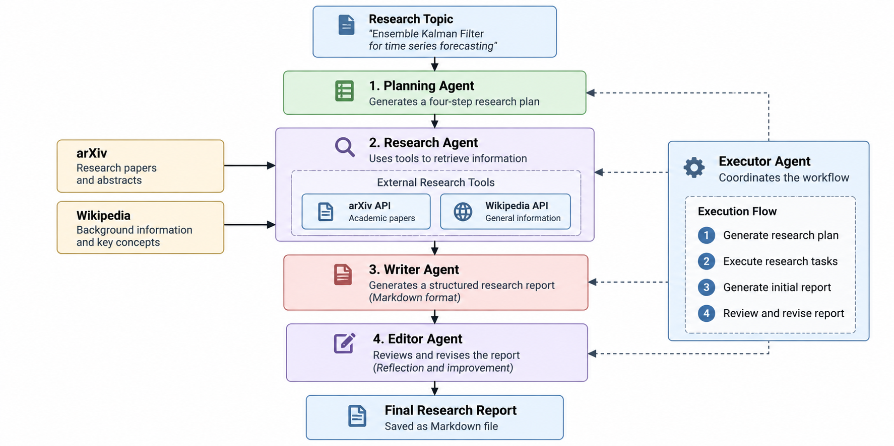

# Multi-Agent Research Assistant

A Python-based multi-agent research system that combines LLM-driven planning, external research tools, report generation, and iterative reflection to produce structured academic research reports.

Developed as an independent portfolio project inspired by the DeepLearning.AI *Agentic AI* course.

## Overview

The system uses four specialised AI agents coordinated by an Executor Agent:

1. **Planning Agent** — generates a structured research plan.
2. **Research Agent** — uses OpenAI function calling to retrieve information from arXiv and Wikipedia.
3. **Writer Agent** — converts research findings into a structured Markdown report.
4. **Editor Agent** — critiques the draft and generates an improved report.

The Executor Agent coordinates the workflow and passes intermediate results between agents.

## Architecture



The current implementation follows a predefined execution sequence, while the Research Agent uses LLM-driven tool selection.

## Technologies

- Python 3.12
- OpenAI API
- arXiv API
- Wikipedia / MediaWiki API
- Jupyter Notebook
- pytest

## Installation

Clone the repository:

```bash
git clone https://github.com/YOUR_USERNAME/multi-agent-research-assistant.git
cd multi-agent-research-assistant
```

Create a Conda environment:

```bash
conda create -n multi-agent-research python=3.12 -y
conda activate multi-agent-research
```

Install dependencies:

```bash
python -m pip install -r requirements.txt
```

Create a `.env` file containing:

```dotenv
OPENAI_API_KEY=your_openai_api_key
```

## Usage

Run the complete workflow:

```bash
python main.py
```

Or open the interactive demonstration:

`notebooks/multi_agent_research_demo.ipynb`

Select the appropriate Python kernel and execute the cells sequentially.

Generated Markdown reports are saved in the `reports/` directory.

## Testing

Run the automated tests using:

```bash
python -m pytest
```

Tests that access external APIs require network connectivity and valid credentials.

## Example Research Topic

*Ensemble Kalman Filter for Time Series Forecasting*

The workflow researches the topic, retrieves academic references, generates an initial report, and performs editorial reflection and revision.

## Current Limitations

- Research coverage is limited to arXiv and Wikipedia.
- Search results may include papers of limited relevance.
- Source abstracts are not equivalent to full-paper analysis.
- Factual accuracy and citation integrity require additional verification.
- The Executor uses a predefined workflow rather than dynamic agent routing.

## Future Improvements

- Source relevance ranking and deduplication.
- Automated citation verification.
- Dynamic agent routing.
- More comprehensive research sources.
- Separate editorial feedback and final-report outputs.
- More extensive automated testing.

## Acknowledgement

Inspired by the agentic workflow concepts taught in DeepLearning.AI's *Agentic AI* course. The implementation uses a modular Python architecture and the official OpenAI SDK.